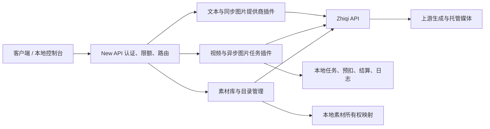

# Allin New API · Zhiqi 接入与平台设计

设计基线：2026-11-13，`wjs7740/allin-new-api` 的 `c9c6da2786b6a0912215127e78e28fbc6650c85f`（上游 `v1.0.0-rc.51`）。

## 1. 产品目标与边界

在 New API 上建设独立运营的多模型平台，以 Zhiqi 为首个上游，覆盖其公开文档描述的文本、图片、视频、模型目录、价格同步和 AIGC 素材能力。本地签发 API Key、管理用户和余额、设置零售价、保存消费记录、隔离用户任务和素材。上游 Key 只保存在服务端渠道配置中。

“覆盖”指本地客户可以通过本平台使用对应能力，管理和计费属于本平台。Zhiqi 的生成执行、原生素材处理和媒体托管由其 API 提供；这些上游服务的内部实现不需要复制到本仓库。本地须明确依赖关系，禁止将上游服务误写成已经自建的模型或存储系统。

保留 New API 的现有渠道、认证、支付、订阅、价格表达式、国际化和项目署名。定制使用独立功能模块和插件，便于继续合并上游更新。

文档依据：`https://zhiqiapi.com/docs` 的公开 Markdown 与 OpenAPI 前端资源。公开文档可能与指定 Key 的模型权限不同；上线验收以实际 Key 的模型目录和回包为准。不开通或猜测未知模型。`minimax-k3` 暂不作为已确认型号，接入使用上游返回的真实 ID。

## 2. 功能清单与实现归属

| 能力 | 本地实现 | 上游依赖 | 验收标准 |
| --- | --- | --- | --- |
| 注册、登录、用户、API Key、余额、充值、订阅 | 复用 New API | 无新增依赖 | 原有功能回归通过 |
| Chat、Responses、Messages、Gemini、Embeddings、TTS | 提供商插件声明原生路由，复用协议处理与计费 | Zhiqi 标准接口 | 流式、非流式、用量及错误传播正确 |
| 模型目录 | 渠道获取模型；接入页读取目录预览 | `/v1/models` | 只启用管理员选择的实际模型 |
| 同步图片、编辑、图片 SSE | 原生图片转发，复用图片用量处理 | `/v1/images/generations`、`/v1/images/edits` | URL 多图、显式零值、SSE 保持正确 |
| 异步图片 | Zhiqi 图片任务插件，新增同名原生路由 | `/v1/images/generations/async`、查询接口 | 返回本地任务 ID、202、正确终态和退款 |
| 视频 | Zhiqi 视频任务插件与统一视频协议 | `/v1/videos`、查询、内容 | 首尾帧、参考图/音/视频、查询和下载 |
| 任务中心 | 复用本地任务表、列表、权限、轮询和日志 | 上游任务状态 | 重启后继续查询；用户间任务隔离 |
| 媒体交付 | 本地鉴权代理或上游托管 URL | Zhiqi 稳定媒体 URL、内容接口 | 交付中保持进行中；失败不重新生成 |
| 素材组、素材、上传、预览 | 本地所有权映射、公共/私有范围、管理 UI | `/api/aigc-assets/*` | 两个用户隔离；管理员只管理本地公共素材 |
| 素材用于视频 | 校验本地素材读取权限并转换为上游 ID | `library_assets` | 私有素材不能跨用户引用，渠道一致 |
| 价格同步 | 上游成本预览、本地独立零售价格 | `/api/pricing_new` | 单位明确、显式确认后修改、本地覆盖保留 |
| 文档中心 | 本地接入说明、可复制示例和接口表 | 无运行时文档依赖 | 使用本站域名和本站 Key，注明模型参数差异 |

## 3. 系统结构

以渠道为连接单元，默认 Base URL 为 `https://zhiqiapi.com`，保持可配置。文本和同步图片使用提供商路由；异步图片和视频各自使用任务插件，避免同一个模型在同步请求和任务请求上出现计价混淆。

插件沿用 type 61；兼容需要绑定任务扩展的 type 60 渠道。模型列表与接口能力通过接入预览生成插件清单，未知能力交给管理员选择，禁止只根据名称就把文本模型标记为视频。

## 4. 对外 API 契约

| API | 行为 |
| --- | --- |
| `GET /v1/models` | 本地 API Key 可访问的模型集合 |
| `POST /v1/chat/completions` | 文本与识图，支持流式 |
| `POST /v1/responses`、`POST /v1/responses/compact` | Responses 原生转发 |
| `POST /v1/messages` | Anthropic 原生格式 |
| `POST /v1beta/models/{model}:generateContent` 及流式变体 | Gemini 原生格式 |
| `POST /v1/embeddings`、`POST /v1/audio/speech` | 嵌入与语音 |
| `POST /v1/images/generations`、`POST /v1/images/edits` | 同步图片/编辑及受支持的 SSE |
| `POST /v1/images/generations/async` | JSON 异步图片，成功返回 202 |
| `GET /v1/images/generations/{task_id}` | 本地图片任务查询 |
| `POST /v1/videos` | JSON 视频创建 |
| `GET /v1/videos/{task_id}`、`GET /v1/videos/{task_id}/content` | 视频状态与内容 |
| `GET /api/pricing_new` | 本地可见模型的零售价格目录；不泄露上游成本或 Key |
| `/api/aigc-assets/groups`、`/assets`、`/uploads` | 下述素材契约 |

视频公开参数包含 `model`、`prompt`、`duration`/`seconds`、`size`、`resolution`、`aspect_ratio`/`ratio`、`input_reference` 及图片别名、参考图片/视频/音频数组、首尾帧、`negative_prompt`、`generate_audio`、`return_last_frame`、`seed`、`n` 和模型专用字段。参数白名单与模型能力分别校验；显式 `false`、`0` 不得丢失。未知字段和冲突别名在收费调用前返回 400。

统一协议默认保留 New API 视频格式；Zhiqi 原生兼容路径返回 `video.task`、`succeeded`、`data[].url`。接入文档必须指出两者的状态名称差异，客户端以所用接口的契约解析。若需要本站 `/v1/videos` 完全采用 Zhiqi 格式，采用明确的兼容配置，而非改变所有已有渠道。

图片异步创建与查询返回 `image.task`、本地公开 ID、`queued/in_progress/succeeded/failed`、进度、时间和结果数组。上游 ID 和 Key 放在私有任务数据中。

## 5. 任务可靠性与账务

状态划分：等待提交、正在提交、等待上游、处理中、交付中、成功、明确失败、提交待核对。业务状态与账务状态独立，禁止仅因客户端断开连接就重发生成请求。

1. 校验最终参数、模型能力和额度。
2. 记录本地提交意图、请求标识与预扣快照。
3. 由指定执行者提交一次上游请求。
4. 收到有效上游任务 ID 后保存绑定，并由现有轮询器更新。
5. 明确失败按可退款标识退款；成功按冻结的价格表达式和已验证用量结算。
6. 网络超时、5xx、成功回包缺任务 ID等受理不确定情况进入待核对，不自动换渠道或重新 POST。

Zhiqi 已接受的任务保持其上游 ID；本地查询错误不代表生成失败。原版对连续查询失败的自动退款策略需要针对 Zhiqi 的待核对任务补充边界，避免上游继续生成、本地已退款。

上游 `media_storage_failed` / `media_storage_unavailable` 属于生成后的交付问题，不自动重新生成；费用是否退回依明确业务策略和上游结果处理，不能套用普通生成失败。

幂等键作用域为用户 + API Key 权限域 + 操作；同一键、同一规范请求返回同一任务，同一键不同请求返回 409。上游未声明幂等支持时不得假定透传请求头就能保证上游幂等。

所有用量在提交前限定上界。计费复用 New API 表达式，图片按有效载荷计张数，视频可按请求次数/秒数/上游有效 Token 计费。缺少准确用量时维持预扣事实，不从金额反推 Token。上游价格只作为成本来源，本地零售价格独立保存；任何自动换算必须标明币种、单位与加价规则。

## 6. 素材库与权限

新增本地资源映射：公开 ID、类型（group/asset/upload）、owner、visibility、channel、upstream ID、父组、状态、必要展示元数据、创建/更新时间。使用普通 GORM 字段，兼容 SQLite、MySQL、PostgreSQL。

上游通常使用同一个商户 Key，因此上游的“私有”并不等于本地用户隔离。本地列表从自己的映射读取，禁止直接把上游整个素材列表返回给用户。查询、更新、删除、预览、上传完成及视频引用均先按 owner/visibility 验证。

- 用户：创建、查看、修改、删除自己的私有组与素材；读取公共素材。
- 管理员：创建与维护本地公共素材；不通过公共接口读取其他用户私有素材。
- 上游资源由本地映射定位；客户端不直接提交任意上游资源 ID。
- 删除组同时清理对应素材映射，失败保持可重试的删除状态。
- 上传初始化绑定 owner、组和渠道；完成接口校验绑定；上传 URL 与凭据不写普通日志。
- `library_assets` 引用必须可读、就绪并属于执行视频的同一上游渠道。

## 7. 管理与用户界面

沿用现有导航和组件，不增加第二套设计系统。

**上游接入页**：连接说明、渠道选择、目录读取、模型与能力预览、插件配置生成、价格预览、配置结果。默认不展示 Key；使用已有渠道密钥输入及访问控制。

**媒体工作台**：图片/视频模式、模型、提示词、规格、参考素材、提交状态、任务记录、预览与下载；支持 API 用户只使用接口，不强制使用工作台。

**素材库**：公共/我的私有、分组、素材类型、名称检索、URL 入库、文件上传、处理状态、预览、删除确认、复制素材引用。

**任务中心**：复用任务列表，增加 Zhiqi 平台筛选与明确的待核对提示；重试只对查询/下载开放，重新生成作为新的显式操作。

**文档**：快速开始、文本、同步与异步图片、视频、素材库、价格与错误；示例使用本地域名，来源和能力限制清晰。

## 8. 开发模块

- `plugins/tasks/zhiqi*/plugin.js`：提供商与媒体协议适配、用量提取、内容请求。
- `controller/zhiqi*.go` / `service/zhiqi*.go`：目录预览、兼容接口、素材上游调用。
- `model/zhiqi*.go`：素材映射和需要持久化的提交记录。
- `router/`：复用现有权限中间件注册路由。
- `web/src/features/zhiqi/`：上游接入、素材和媒体操作页面。
- `docs/zhiqi-*.md`：架构、接口、配置与验收记录。

## 9. 实施顺序与验收门槛

1. 完整设计与接口清单落盘。
2. 提供商、视频和异步图片插件，覆盖参数、状态、私有 ID 与用量。
3. 目录接入、价格预览与配置流程。
4. 素材映射、引用权限、上传与管理界面。
5. 提交可靠性、待核对、交付失败账务边界。
6. 媒体工作台、文档与端到端联调。

每项需记录“已实现/已验证/待实网验证”，不能用设计完成代替功能完成。

验证包括：插件真实宿主加载；成功、明确失败、未知状态、429/5xx、超时、缺任务 ID；图片对象/拆分/空载荷；视频参数上下界、零值与别名冲突；用户隔离与私有 ID；同任务重复查询不重复结算；断线和重启；前端类型、lint、行为测试和生产构建。

涉及数据库的新增和改动须在真实 SQLite、MySQL、PostgreSQL 上验证，新建和升级路径分别执行两次迁移。现有项目其他数据库和容器不作为测试目标。

实网验收需在后台配置 Zhiqi Key，先读取模型/价格，再以管理员选择的少量模型进行有费用调用。费用调用和公开部署单独记录，单元测试不访问付费接口。

## 10. 尚待实网确认

- 指定 Key 的模型与价格权限、Muse 和 MiniMax 的实际 ID。
- 价格目录中计价单位、规格维度与能力字段的实际回包。
- 上游任务查询保存期、下载 URL 有效期、素材上传约束。
- 上游对请求幂等、任务核对与退款的可用接口。

这些不确定项通过显式配置与能力检测处理；未确认价格或能力的模型保持未上架。
